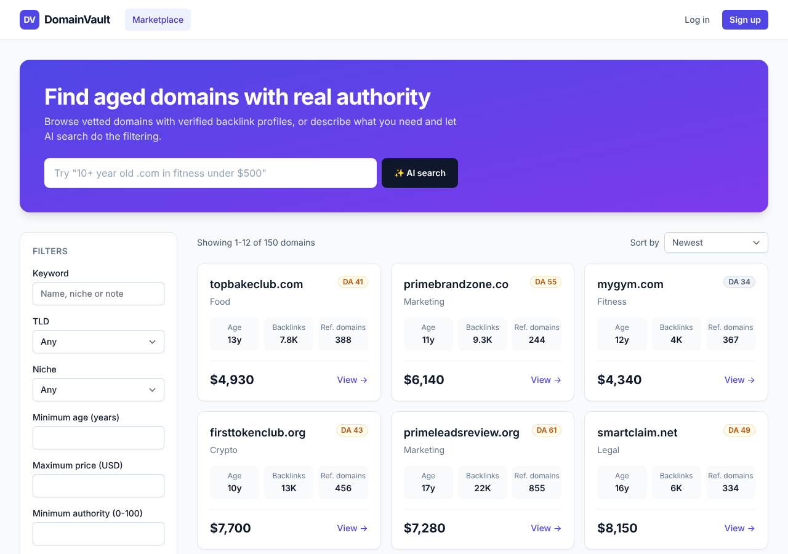
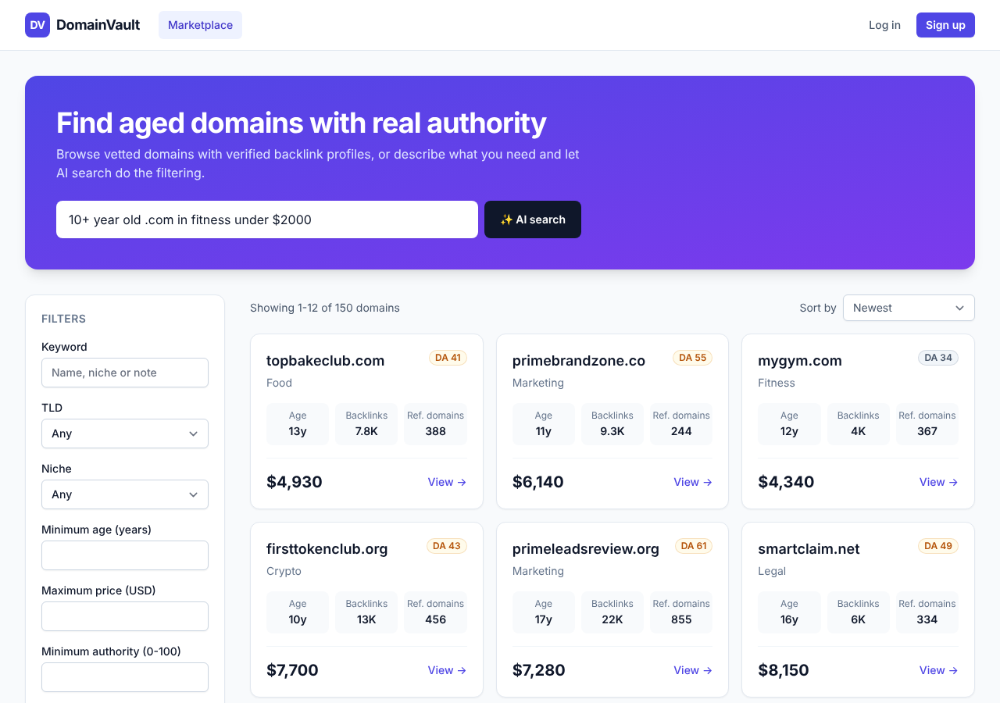
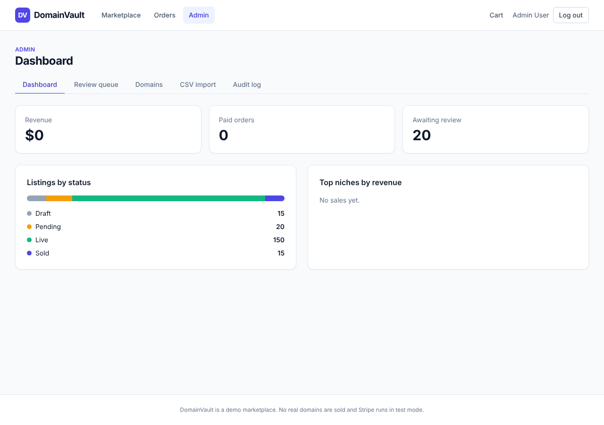
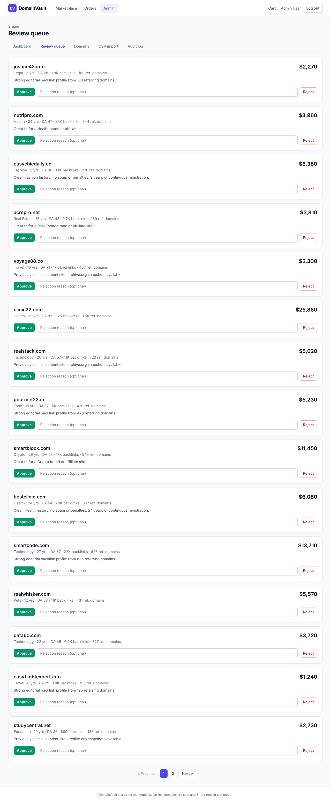
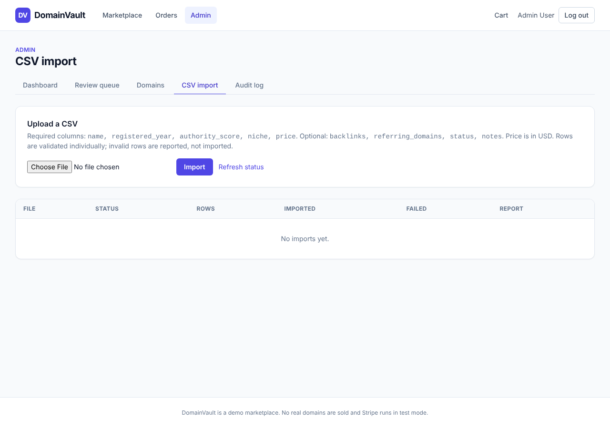

# DomainVault

A demo **aged-domain marketplace** built as a portfolio project: browse and buy aged domains, search them in plain English with an LLM, check out with Stripe, and run the catalogue from an internal admin panel.

> Demo only. No real domains are sold and Stripe runs in test mode.



| AI search with removable chips | Admin dashboard |
| --- | --- |
|  |  |
|  |  |

## Features

- **Marketplace**: paginated listings, filters (TLD, min age, max price, min authority, niche), sorting, free-text search (Laravel Scout, database driver) and detail pages.
- **AI domain search**: type *"10+ year old .com in fitness under $500"*. The backend asks an LLM for structured filters, validates every field, applies them and shows them as removable chips.
- **Cart and Stripe Checkout** (test mode), a signature-verified webhook that marks the order paid and the domain sold, and an order history page.
- **Admin panel**: CSV bulk import (queued job, row-level validation, downloadable error report), a review queue (approve/reject), status changes, an audit log of admin actions and dashboard stats (listings by status, revenue, top niches).
- **REST API** (Sanctum tokens): list/filter domains with API resources and rate limiting.

## Stack

Laravel 12 (PHP 8.3) · MySQL (SQLite for tests) · Inertia.js + React + TypeScript + Tailwind · Breeze auth with `admin`/`buyer` roles · Scout (database driver) · database queue · `stripe/stripe-php` · Sanctum · Pest · Pint · GitHub Actions.

## Setup

Requirements: PHP 8.3+, Composer, Node 22+, MySQL 8 (or SQLite for a zero-setup try-out).

```bash
git clone https://github.com/ukpokolo/domainvault.git && cd domainvault
composer install
npm install
cp .env.example .env
php artisan key:generate

# MySQL (default): create the database, then set DB_* in .env
mysql -uroot -e "CREATE DATABASE domainvault"
# ...or use SQLite instead: set DB_CONNECTION=sqlite and `touch database/database.sqlite`

php artisan migrate --seed     # 2 demo users + 200 domains
npm run build                  # or `npm run dev` for HMR

php artisan serve              # http://localhost:8000
php artisan queue:listen       # needed for CSV imports (QUEUE_CONNECTION=database)
```

Add the standard cron entry `* * * * * php artisan schedule:run` to run the hourly `orders:expire-stale` task, which closes unpaid orders older than 24h.

`composer dev` starts the server, queue worker and Vite together.

### Demo credentials (demo only, never reuse)

| Role  | Email                    | Password   |
| ----- | ------------------------ | ---------- |
| Admin | `admin@domainvault.test` | `password` |
| Buyer | `buyer@domainvault.test` | `password` |

### Environment

| Variable | Purpose |
| --- | --- |
| `LLM_DRIVER` | `anthropic` (default) or `fake`. The fake driver uses a small rule-based parser, so AI search works without an API key. |
| `ANTHROPIC_API_KEY`, `ANTHROPIC_MODEL` | Credentials/model for the Anthropic Messages API. |
| `STRIPE_KEY`, `STRIPE_SECRET` | Stripe **test** keys. |
| `STRIPE_WEBHOOK_SECRET` | Signing secret from `stripe listen`. |
| `SCOUT_DRIVER` | `database` (default). |

### Trying the Stripe flow locally

```bash
stripe listen --forward-to localhost:8000/stripe/webhook   # prints the whsec_... secret for .env
```

Add a domain to the cart, check out and pay with `4242 4242 4242 4242` (any future date and CVC). The webhook marks the order paid and the domain sold.

## API

```bash
# 1. Get a token (rate limited to 5/min per IP)
curl -X POST localhost:8000/api/tokens -H 'Accept: application/json' \
  -d email=buyer@domainvault.test -d password=password -d device_name=cli

# 2. List and filter live domains (60 requests/min per token)
curl 'localhost:8000/api/domains?tld=com&min_age=10&max_price=500&sort=price_asc&per_page=20' \
  -H "Authorization: Bearer <token>" -H 'Accept: application/json'
```

Filters: `q`, `tld`, `niche`, `min_age`, `max_price` (USD), `min_authority`, `sort`, `per_page` (max 50). Tokens carry only the `domains:read` ability.

## Architecture

```
app/
  DTOs/DomainFilters        one validated filter shape shared by web, AI and API
  Enums/                    DomainStatus (with allowed transitions), OrderStatus, UserRole
  Services/
    Search/                 DomainSearchService, FilterChips
    Ai/                     AiSearchService, LlmClient (interface), AnthropicLlmClient, FakeLlmClient
    Cart/                   CartService
    Checkout/               CheckoutService, PaymentGateway (interface), StripePaymentGateway, FakePaymentGateway
    Import/                 DomainCsvImporter (streams + validates rows)
    Admin/                  ListingReviewService, AuditLogger, DashboardStats
  Jobs/ImportDomainsJob     queued CSV import
  Policies/                 Domain, Order, ImportBatch, AuditLog
  Http/                     thin controllers, form requests, API resources
resources/js/               Inertia pages (Marketplace, Cart, Orders, Admin) and shared components
```

Request flow for AI search:

```
search box -> GET /ai-search -> AiSearchService -> LlmClient (Anthropic | Fake)
           -> JSON reply -> per-field validation -> DomainFilters
           -> redirect to /?tld=com&min_age=10... -> DomainSearchService -> chips + results
```

### Database schema

| Table | Key columns |
| --- | --- |
| `users` | `role` (`admin`/`buyer`) |
| `domains` | `name` (unique), `tld`, `registered_year`, `backlinks`, `referring_domains`, `authority_score`, `niche`, `price_cents`, `status` (`draft`/`pending`/`live`/`sold`), `notes`, `sold_at` |
| `cart_items` | `user_id`, `domain_id` (unique pair) |
| `orders` / `order_items` | status, `total_cents`, `stripe_session_id` (unique); items snapshot `price_cents` |
| `import_batches` | file, status, row counts, `error_report_path` |
| `audit_logs` | `user_id`, `action`, polymorphic subject, `meta` JSON |

Every public query filters on `status`, so the composite indexes on `domains` lead with it: `(status, tld)`, `(status, niche)`, `(status, price_cents)`, `(status, authority_score)`, `(status, registered_year)`.

## Testing and code style

```bash
vendor/bin/pest          # feature + unit tests (in-memory SQLite, Stripe and LLM faked)
vendor/bin/pint          # code style (CI runs `pint --test`)
npx tsc --noEmit         # frontend type check
```

Coverage highlights: every search filter and sort; an N+1 guard on the listing; the AI service with a scripted fake client (including malformed and hostile model output); checkout, the signed webhook, idempotency and double-sell protection; CSV import with row errors; authorization for guests, buyers and admins on every admin route; API auth, abilities, validation and throttling.

## Design decisions

- **One filter object for three entry points.** `DomainFilters` plus a single `rules()` method serve the web form, the REST API and the LLM output validator, so they cannot drift apart.
- **The LLM never touches SQL.** It may only return a small JSON object. Each key is whitelisted and validated on its own (types, ranges, niche must exist in inventory); invalid values are dropped, not trusted. If the provider fails or replies with junk, the user gets a keyword search and a notice instead of an error. The client sits behind `LlmClient`, so tests use `FakeLlmClient` and no network.
- **AI results are plain URLs.** The AI endpoint redirects to the normal listing with query parameters; chips are derived from the active filters, so removing a chip is a normal link and costs no LLM call. Results are shareable and bookmarkable.
- **`stripe-php` instead of Cashier.** Cashier is built around billable models and subscriptions; this app needs one-off Checkout sessions. A small `PaymentGateway` interface keeps Stripe at the edge and checkout logic testable. Webhook tests use real HMAC-signed payloads, so signature and timestamp verification are exercised, not mocked.
- **Fulfilment is idempotent and race-safe.** The webhook locks the order and domain rows in a transaction. Redelivered events are no-ops; if two buyers pay for the same unique domain, the second order is marked `failed` with a reason (a refund is handled manually) rather than selling twice. Checkout also re-checks availability before creating a session.
- **No `carts` table.** A user has exactly one cart, so `cart_items (user_id, domain_id)` is enough.
- **Money as integer cents**, with price snapshots on order items.
- **Age is computed** from `registered_year`, never stored, so it cannot go stale.
- **Sold is terminal and system-controlled.** `DomainStatus::allowedTransitions()` encodes what admins may do; only a confirmed payment sets `sold`.
- **Import is streamed and validated per row.** A bad row never blocks good ones; failures go to a downloadable CSV (with spreadsheet-formula neutralisation). A crashed job marks the batch `failed` instead of leaving it stuck.
- **Authorization in layers.** Route middleware (`admin`) for the section, policies for model actions, form requests with `authorize()`, and `role` is not mass-assignable. Unpublished domains return 404 on the API rather than leaking their existence.
- **Scout driver is configurable.** The database driver works out of the box. Meilisearch is a config switch, but it needs the `meilisearch/meilisearch-php` package, which is not installed by default.
- **Known limitations (demo scope).** No email notifications, no seller self-service listing flow (draft/pending listings come from CSV import and the seeder), and no automatic refunds for the rare double-payment case.
